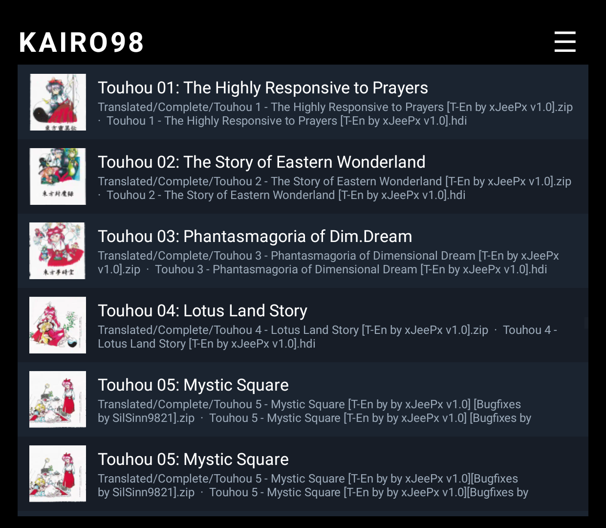
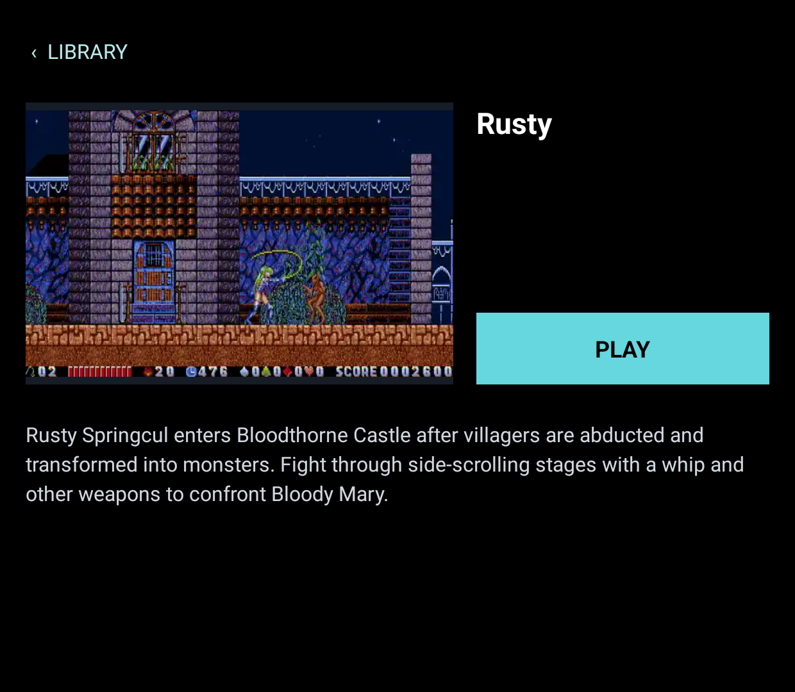
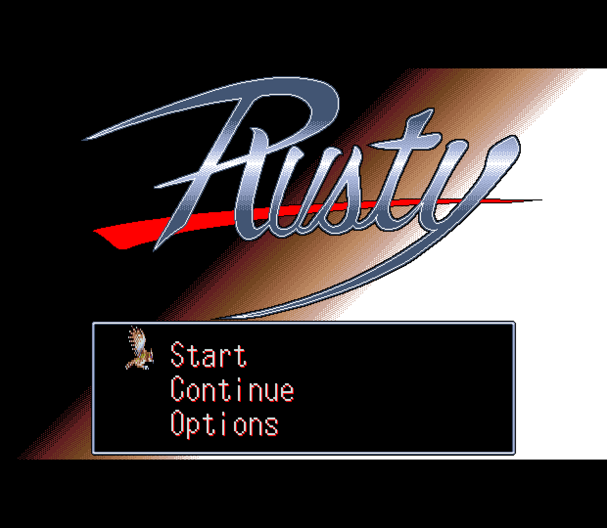
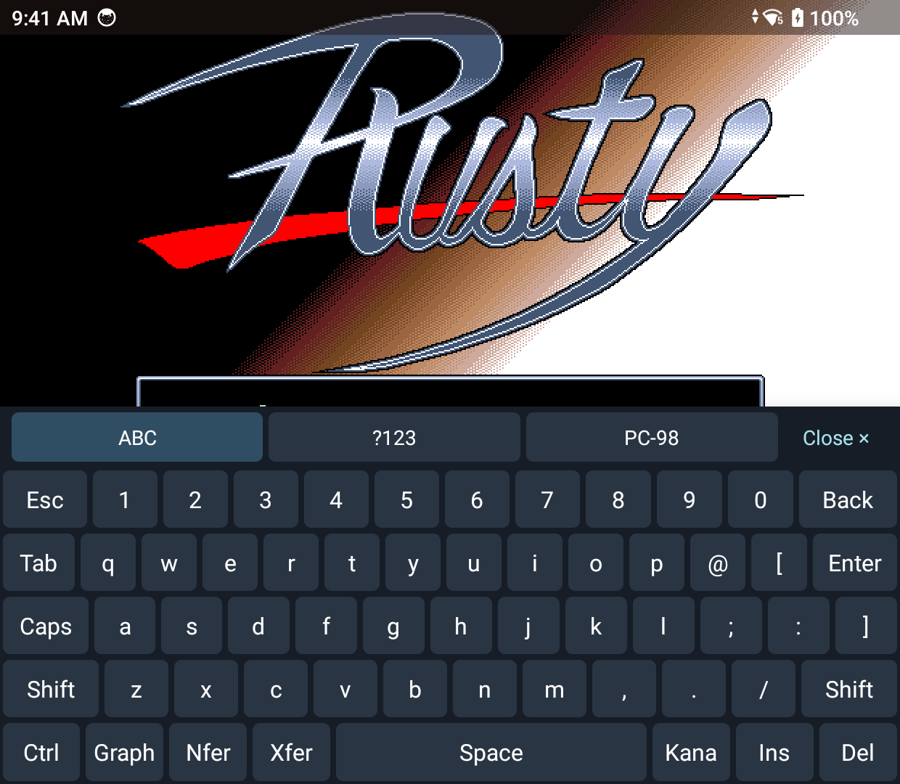

<!-- kairo:discord -->
<p align="center">
  <a href="https://discord.gg/ZkYQ3bPTTq"></a>
</p>
<!-- /kairo:discord -->

<!-- kairo:family -->
<h3 align="center">Other Kairo apps</h3>
<table align="center">
  <tr>
    <td align="center" width="33%"><a href="https://github.com/MrJackSpade/KairoDos"><br><b>KairoDos</b></a><br>DOS</td>
    <td align="center" width="33%"><a href="https://github.com/MrJackSpade/Kairo88"><br><b>Kairo88</b></a><br>PC-88</td>
    <td align="center" width="33%"><a href="https://github.com/MrJackSpade/Kairo68"><br><b>Kairo68</b></a><br>X68000</td>
  </tr>
  <tr>
    <td align="center" width="33%"><a href="https://github.com/MrJackSpade/KairoTowns"><br><b>KairoTowns</b></a><br>FM Towns</td>
    <td align="center" width="33%"><a href="https://github.com/MrJackSpade/KairoMSX"><br><b>KairoMSX</b></a><br>MSX</td>
  </tr>
</table>
<p align="center">Every Kairo app is built on <a href="https://github.com/MrJackSpade/Kairo">Kairo</a>, the shared frontend for the game library, controls, and settings.</p>
<!-- /kairo:family -->

# Kairo98

**Play your own PC-98 games on Android phones and handhelds.** Kairo98 gives you a game library with artwork, controller and touch controls, an on-screen PC-98 keyboard, save states, and per-game settings. It runs a pinned [Neko Project 21/W](https://simk98.github.io/np21w/) core with [ymfm](https://github.com/aaronsgiles/ymfm) sound emulation. It is an independent project, not an official release of either core.

<!-- kairo:play-badge -->
[](https://play.google.com/store/apps/details?id=com.loxifi.kairo98)
<!-- /kairo:play-badge -->

## Contents

- [Download](#download)
- [Screenshots](#screenshots)
- [Quick start](#quick-start)
- [Supported disk formats](#supported-disk-formats)
- [Managing your library](#managing-your-library)
- [Controls](#controls)
- [Firmware and fonts](#firmware-and-fonts)
- [Launching from other frontends](#launching-from-other-frontends)
- [Documentation](#documentation)
- [Help and community](#help-and-community)
- [Building from source](#building-from-source)
- [License](#license)

## Download

<!-- kairo:download -->
- **[Google Play](https://play.google.com/store/apps/details?id=com.loxifi.kairo98)** (paid): updates automatically. Buying it supports development.
- **[GitHub Releases](https://github.com/MrJackSpade/Kairo98/releases)** (free): install the APK yourself. The larger `-with-images` APK also bundles catalog artwork.

Both editions are built from the same source and have the same features. Requires an ARM64 device running Android 8.0 or newer.
<!-- /kairo:download -->

## Screenshots

| Game library | Game details |
| --- | --- |
|  |  |
| **Playing a game** | **On-screen keyboard** |
|  |  |

Games shown in screenshots are user-provided and are not bundled with the app.

## Quick start

1. Install Kairo98 from [Google Play](https://play.google.com/store/apps/details?id=com.loxifi.kairo98) or [GitHub Releases](https://github.com/MrJackSpade/Kairo98/releases).
2. Open Kairo98 and select a folder containing your PC-98 disks. You can change it later in **Menu › Manage library**.
3. Select a game, review its details, and tap **Play**.

Games, operating systems, and firmware are not supplied. Some games need a separate boot disk, a manual disk swap, or [imported firmware](#firmware-and-fonts).

## Supported disk formats

| Type | Formats |
| --- | --- |
| Hard disks | HDI |
| Floppies | FDI, D88, NFD, FDD, DCP/DCU, HDM, XDF |
| Archives | Any of the above inside ZIP files |

Games are recognized by their disk contents, so recompressing a ZIP does not change how it matches. A ZIP holding several disks shows up as separate library entries. Details: [game catalog](docs/game-catalog.md).

## Managing your library

- **Artwork.** **Menu › Manage library** can download missing artwork for games Kairo98 recognizes.
- **Catalog updates.** **Update catalogs** on the same page fetches the latest titles, descriptions, and launch settings without an app update.
- **Disk saves.** A game plays from its own working copy of each disk, which keeps what the game writes to it. Editing the disk image in your games folder does not replace that copy; **Game settings › Reset disk** does. Saves, save states and settings belong to the game's place in your games folder, so renaming or moving a game makes it a new game.
- **Save states.** Saved in private app storage by default. To use a folder of your choice, choose **Menu › Configurations › Save folder › Custom folder**. Changing the folder moves your save states; if a slot exists in both places, you choose which copy to keep.
- **Deleting a game file.** Open the game's **Game settings** and choose **Delete game file**. Kairo98 names the file before deleting it; deleting a ZIP removes every game inside it. Saves and settings are kept. If the folder grant is read-only, select the folder again to grant write access.
- **Startup choices.** Some cataloged games ask a menu question before play; Kairo98 can answer it for you or let you **Play manually**. See [startup choices](docs/startup-choices.md).

## Controls

| Action | How |
| --- | --- |
| Open the game menu | Android Back, a left-edge swipe, or the controller Menu/Mode button |
| Show the PC-98 keyboard | Swipe from the right edge |
| Remap a controller | Map buttons and sticks to PC-98 keys, joystick, mouse, or app actions; layouts are saved per game |
| Use touch controls | The same per-game layout works with on-screen controls |
| Use a second screen | A second Android display can show the keyboard or touchpad during play |

The game menu offers save states, disk changes, game and app settings, restart, and return to the library.

## Firmware and fonts

Kairo98 has a built-in BIOS and font, so every file is optional. Menu › Machine lists every BIOS file, each marked Required or Optional. Pick each file, or use **Import all from a folder…** to import every file the app recognizes in a folder you choose. A game that needs the PC-98's own BIOS, font, or the YM2608 rhythm samples uses the ones you import.

A `FONT.BMP` placed in a game's ZIP or library folder overrides the imported font for that game; the one nearest the disk image wins.

## Launching from other frontends

<!-- kairo:frontend-guides -->
Kairo98 can open a game sent from another Android frontend; no library folder is needed. Step-by-step setup:

- [LaunchBox for Android](docs/frontends.md#launchbox-for-android)
- [ES-DE](docs/frontends.md#es-de)
- [iiSU](docs/frontends.md#iisu)
- [Beacon](docs/frontends.md#beacon)
<!-- /kairo:frontend-guides -->

## Documentation

- [External frontend setup](docs/frontends.md): LaunchBox, ES-DE, iiSU, and Beacon configuration
- [Game catalog](docs/game-catalog.md): how games are matched, catalog updates, metadata overrides
- [Startup choices](docs/startup-choices.md): automatic menu answers and disk swaps before play
- [Release notes](docs/releases/README.md): changes in every version
- [Licensing and credits](docs/licensing.md): code license and third-party components
- [Source provenance](docs/source-import.md): imported emulator, sound, and font sources and local changes
- [Catalog source data](catalog/research/README.md): research records behind the catalog

## Help and community

<!-- kairo:community -->
- **Report a game problem** in [Issues](https://github.com/MrJackSpade/Kairo98/issues). Include the title, disk format, and what happened.
- **Chat** with other players on [Discord](https://discord.gg/ZkYQ3bPTTq).
<!-- /kairo:community -->
- **English patches** for PC-98 games live in the separate [Kairo98 translation project](https://github.com/MrJackSpade/Kairo98-Patches).

## Building from source

<!-- kairo:clone -->
Clone with submodules to get the pinned shared frontend:

```sh
git clone --recurse-submodules https://github.com/MrJackSpade/Kairo98.git
```
<!-- /kairo:clone -->

## License

<!-- kairo:license -->
First-party code is [GPL-2.0-or-later](LICENSE.md). The app as distributed is GPLv3 because it bundles GPLv3 components. Third-party components keep their own licenses; see [licensing and credits](docs/licensing.md) and [source provenance](docs/source-import.md).
<!-- /kairo:license -->
