# Add a game

Add a game the catalog doesn't know, such as your own copy of a multi-disk game, and set it up yourself: group its disks, name it, choose what it starts from, and play. Everything here is done from Kairo98's own screens, and all of it is kept.

## 1. Add the disks

Copy the game's disks into your games folder (a folder of their own keeps them together), then open the library menu › **Refresh**. A game the catalog doesn't know is listed under its file names, one entry per disk.

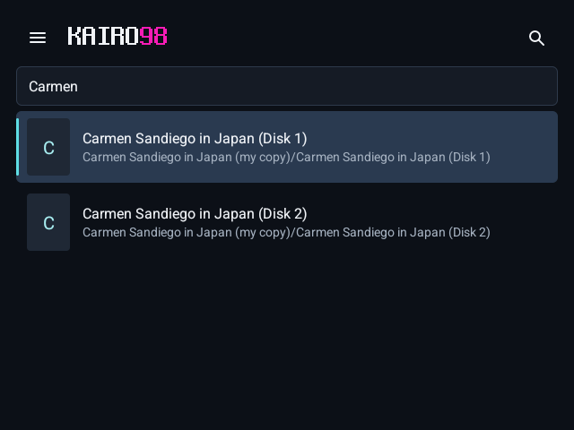

## 2. Group them into one game

Open the disk the game starts from (usually Disk 1) › **Game settings**. Under **Library**, **Disks** shows the game's disks.

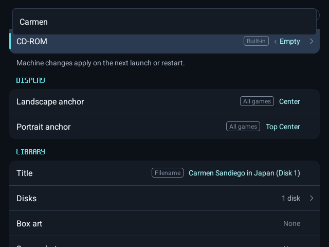

Switch on the game's other disks. They leave the library list and become this game's disks; the row reads "2 disks".

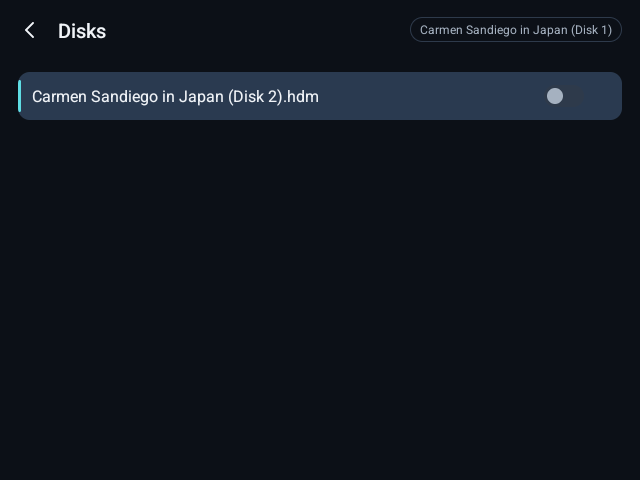

## 3. Name it

Under **Library**, **Title**: type the game's name. **Box art** and **Screenshot** take images from your device.

## 4. Choose its drives

The game starts from the disk you grouped the others on. Under **Machine**, put its other disks where it expects them: here **Drive 2** holds Disk 2.

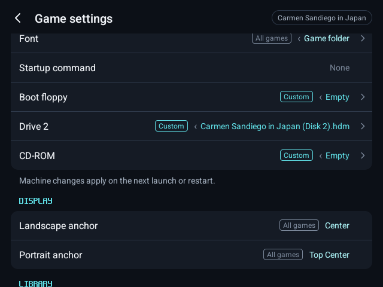

## 5. Firmware

Under **Machine**, **System** chooses the built-in BIOS or your own. A missing BIOS of your own is named when the game starts.

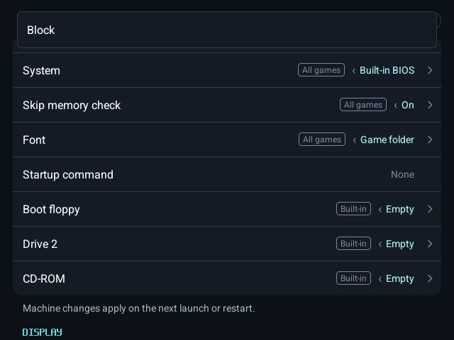

## 6. Configure

Everything else in Game settings (controls, machine, display) is kept for this game alone.

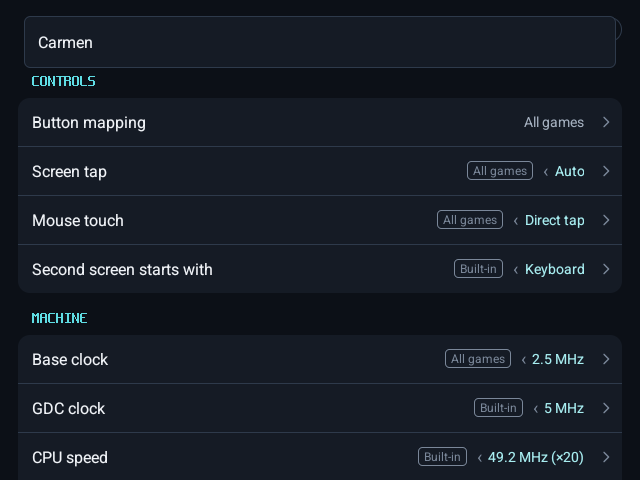

## 7. Play

Press **Play**.

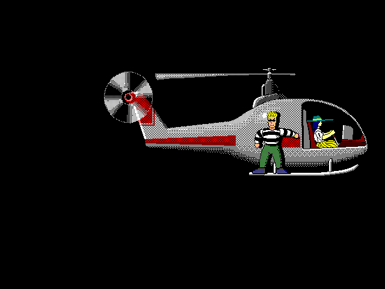

In the menu, **Disks** shows each drive; the game's disks are listed first, under **This game**, for swapping when it asks.

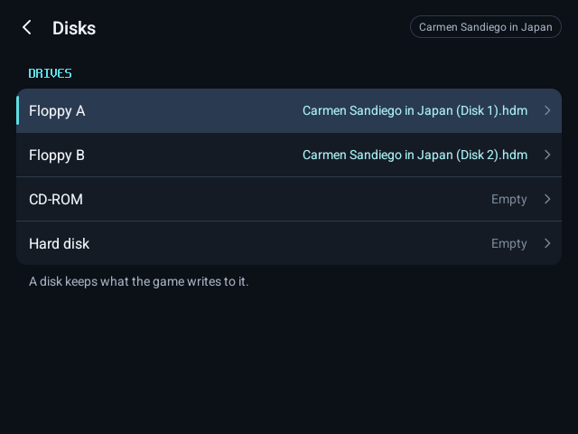

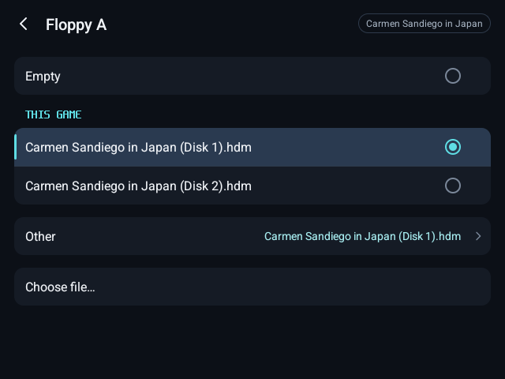

## 8. It is kept

Save your progress with **Save state**, as with any game.

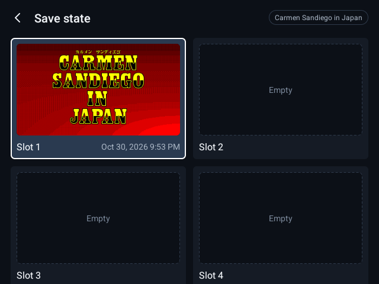

After closing and reopening Kairo98, the game is still one game with its name, disks and settings, and **Load state** brings back your progress.

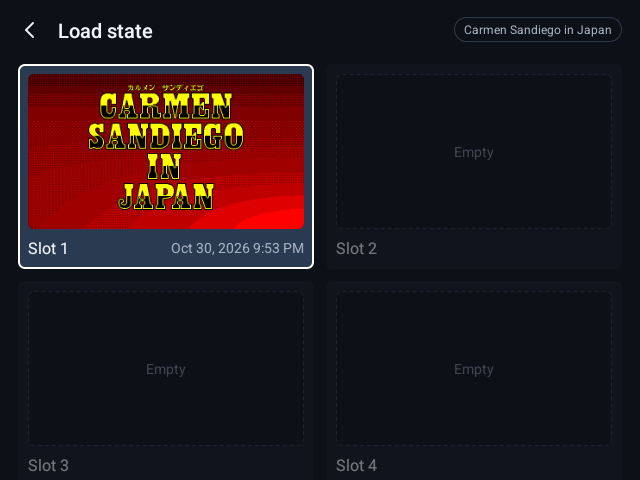
