# Create a game

Make a new game on a blank hard disk: MS-DOS formats it, a game's installer copies itself onto it, and the disk is kept as a game in your library that starts by itself. The MS-DOS system floppy and the installer disks can stay wherever they are (for example in Download): the Disks page puts them in a drive from anywhere on the device.

## 1. Make a blank disk

Open the library menu › **Manage library**. Under **New game**, choose a disk: **Hard disk · 40 MB · SASI** here. **Floppy disk · 1.2 MB · 2HD** and the 20 MB hard disk are made the same way.

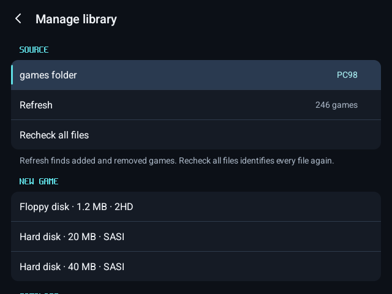

Name it and press **Create**.

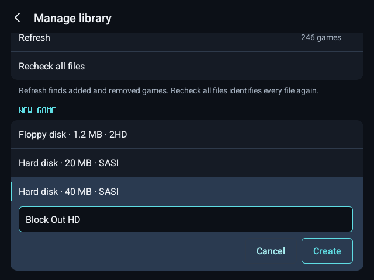

The blank disk is saved in your games folder, in a folder of its own, and listed as a game.

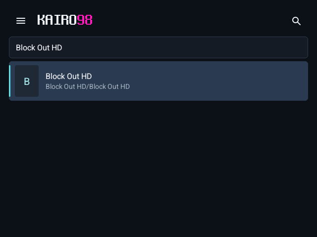

## 2. Start MS-DOS with the new disk attached

Press **Play**. With nothing on the hard disk yet, the PC-98 says so (このハードディスクイメージはフォーマットされていません).

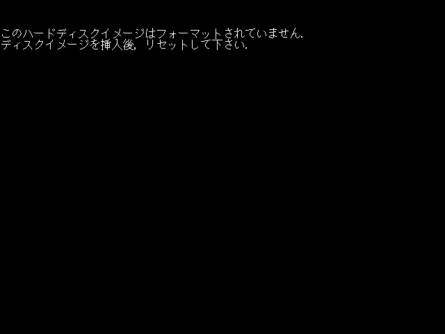

Open the menu › **Disks** › **Floppy A** › **Choose file…** and pick your MS-DOS system floppy; put the game's installer disk in **Floppy B** the same way.

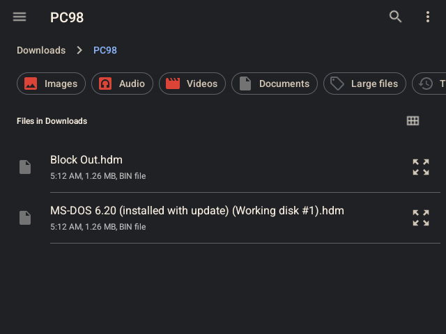

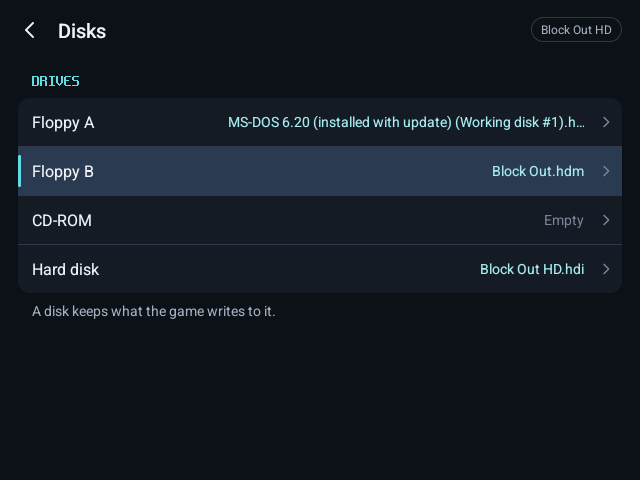

Menu › **Restart game** (the drives are kept): MS-DOS starts from the floppy.

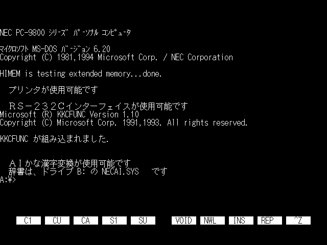

## 3. Format it

Type `format` and choose **固定ディスク** (fixed disk). Run **初期化** (Initialize) on the whole disk, then **領域確保** (Allocate): the full size, **システム** (System) **転送する** (transfer), **実行** (Run).

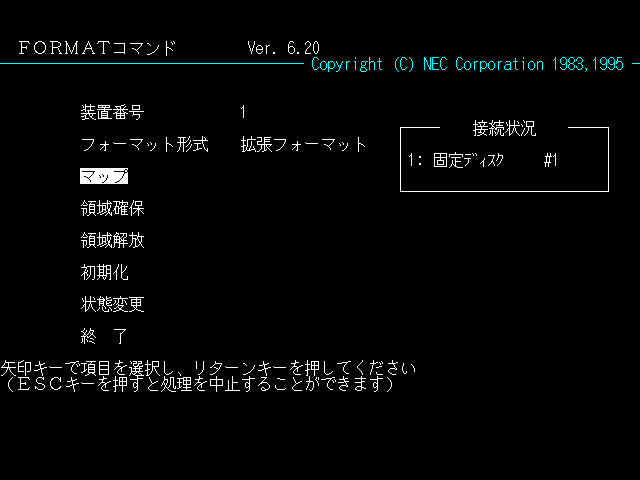

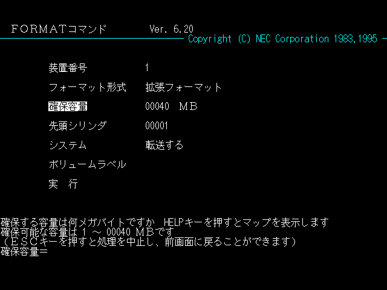

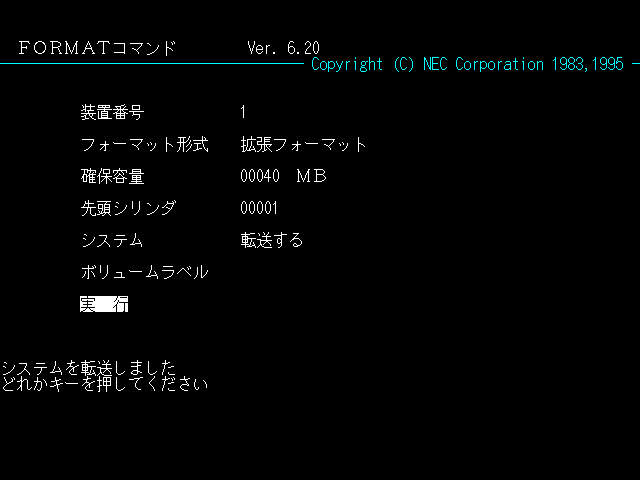

Leave FORMAT with Esc and **Restart game**: `dir c:` shows the new drive with MS-DOS on it.

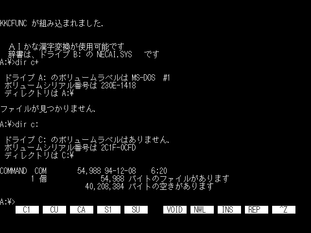

## 4. Install your game on it

Empty the floppy drives in **Disks** and **Restart game**: the hard disk now starts MS-DOS by itself, and is drive A:. Press Enter at the date and time.

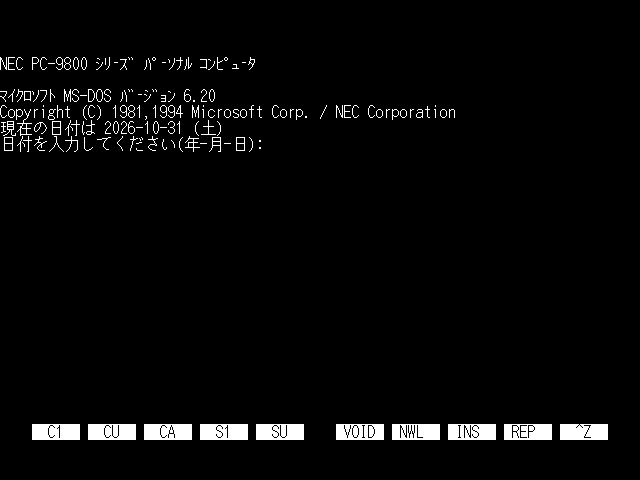

Put the installer disk in **Floppy A** (it is drive B: now) and run its installer, here `b:` then `install a:`.

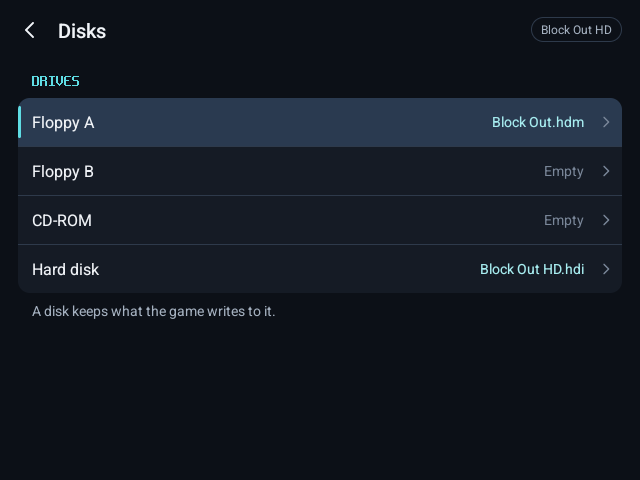

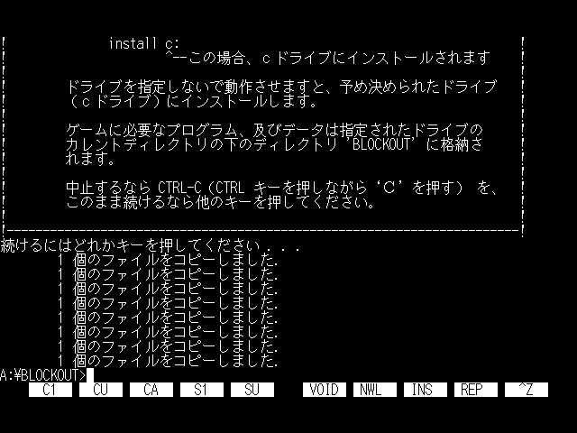

To start the game straight away whenever the disk boots, write a start-up file:

```
echo cd \blockout>a:\autoexec.bat
echo jelly>>a:\autoexec.bat
```

Type `:` and `>` from the on-screen keyboard's **?123** page: a hardware keyboard's US layout doesn't match the PC-98's.

## 5. It is kept

Empty Floppy A in **Disks** and return to the library. The hard disk keeps everything MS-DOS and the installer wrote to it. After closing and reopening Kairo98, the new game is under **Continue**, and **Play** starts it from the hard disk alone, straight into the game.

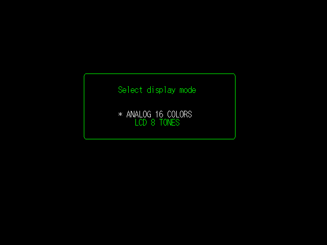

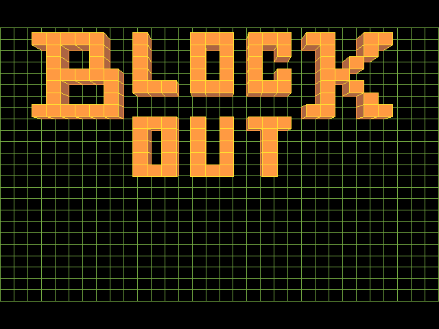
